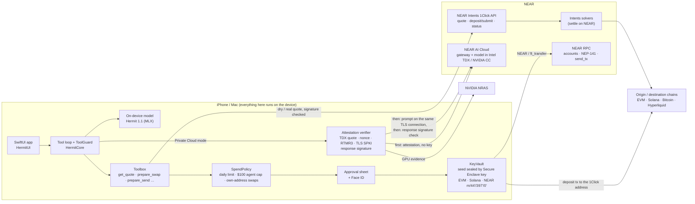

# Hermit

**A self-custody wallet for iPhone and Mac with a private AI assistant. The assistant runs on the phone. It moves money
across chains through NEAR Intents. For bigger questions it can use a NEAR AI Cloud enclave, which the phone verifies
before it sends anything.**

**The problem.** An AI assistant that helps with money has to see your balances, your addresses and what you want to
do. Today that means one of two things. Either a company's server reads all of it, or the agent holds keys it could be
tricked into using. Hermit keeps the chat on the phone by default. When the phone isn't enough, Hermit uses a
hardware enclave and checks the enclave's proof on the phone. The assistant can only *prepare* a move. A spending policy
checks every move, and the user approves each one with Face ID.

| | |
| --- | --- |
| iPhone (TestFlight, public) | https://testflight.apple.com/join/ed9vUh7d |
| Mac (TestFlight) | https://testflight.apple.com/join/P66H5DF8 (in Apple beta review; may not open yet) |
| Demo video | `TODO: link to the X post / video` |
| Built at | NEAR HACKATHON, 2026-11-01 to 2026-11-14 ([disclosure](#hackathon-disclosure)) |
| Tracks | Privacy & Private AI · Unstoppable DeFi · AI Security & Defense |
| NEAR used | NEAR Intents (1Click API) · NEAR accounts and NEP-141 · NEAR AI Cloud (TEE inference with attestation) |
| License | MIT ([LICENSE](LICENSE)) |

---

## Try it in 2 minutes

### (a) On an iPhone (TestFlight)

iOS 26. An iPhone 15 Pro or later gets the full on-device model; older iPhones get the Lite model.

| # | Do | See |
| --- | --- | --- |
| 1 | Install from https://testflight.apple.com/join/ed9vUh7d. Open Hermit, enter a name, and create a wallet (Face ID). | Home. **Wallets** lists one wallet with an EVM address, a Solana address and a **NEAR account** (a 64-character hex implicit account derived on the phone). |
| 2 | **Wallets**, then **Try a quote**. This button is shown while the wallet is empty. Choose 10 USDC on Base to NEAR. | A live NEAR Intents (1Click) quote, shown next to a Relay quote, with the better one picked. You see the amount out (about 2.69 NEAR for 10 USDC on 2026-11-08), fees and time (about 35 s). It is a dry quote, so there is nothing to sign. |
| 3 | **Wallets**, then **Add funds**, then **From any chain, via NEAR Intents** (the sheet is titled "Add funds from any chain"). Pick a source such as BTC on Bitcoin, enter an amount, and continue. | A one-time 1Click deposit address with a QR code, "Address valid until …", and a four-step tracker: deposit, seen, swap, delivered. Funds land as USDC on Base in this wallet. **This is mainnet. Send nothing unless you mean it.** |
| 4 | In the chat box, tap the model name next to Send and choose **Private Cloud**. | The Home card checks NEAR AI's enclave live and shows **"Enclave verified, no key needed for that."** (or "*model* in an enclave this phone just verified"). Tap the shield to see every check: Intel TDX quote, nonce, signer, MRCONFIGID, RTMR3, GPU, TLS. |
| 5 | Ask: **"swap 20 USDC on Base to NEAR"**. | A step line, "Getting a NEAR Intents quote for 20 USDC to NEAR", then the answer. In Private Cloud mode each reply gets a **Verified in a TEE** chip: tap it to see the response signature check. If the assistant prepares the swap, the Swap review opens prefilled and waits for your Face ID. With an empty wallet, Review stops at the balance check. |
| 6 | Ask: **"swap 500 USDC on Base to NEAR"**. | Blocked before any review opens: "The assistant can prepare up to $100 per move. Open Swap yourself for more." |
| 7 | Turn on Airplane mode. Switch back to **On-device** and ask a question. | The on-device model (Hermit 1.1) still answers. Nothing leaves the phone. The model download starts by itself on first launch (about 2.3 GB, or 1 GB for Lite). |

Private Cloud chat needs a NEAR AI Cloud key: add one in **Settings > Private Cloud**. You can get one at https://cloud.near.ai,
or claim $10 of credit through NEAR Builders. TestFlight builds may carry Hermit's shared key with 30 free messages per
device per day. Without a key, the enclave check in step 4 still runs, and a message is not sent: the reply says why.

### (b) No iPhone: the same NEAR code paths on Linux or macOS

Python 3.10 or later. No keys or funds are needed for steps 1 to 4.

```sh
git clone https://github.com/Hermit-Ai-Labs/hermit-app && cd hermit-app
python3 -m venv .venv && .venv/bin/pip install -r near/requirements.txt
```

| # | Do | See |
| --- | --- | --- |
| 1 | `.venv/bin/python near/intents-quote.py` | A live dry 1Click quote for 10 USDC on Base to NEAR. You see the amount out, the minimum out, `1Click fee 20 bps`, the time estimate, `deposit address none (dry quote …)`, and `[PASS] 1Click signature`. Exit code 0. |
| 2 | `.venv/bin/python near/intents-quote.py --selftest` | `8 passed, 0 failed`. The Python port of the quote-signature check gives the same hashes as the Swift tests and the official SDK, and it rejects a swapped deposit address. |
| 3 | `.venv/bin/python near/near-account.py` | From the public test phrase `abandon ×11 about`: path `m/44'/397'/0'`, `ed25519:6j4b6zUa…`, implicit account `5510e2b4…ee412`, and three `[PASS]` lines against the Swift test vector. Then the account's NEAR and NEP-141 balances on mainnet, read-only. |
| 4 | `.venv/bin/python near/verify-attestation.py` | A fresh nonce, then the live NEAR AI Cloud report, verified step by step. You see `23 passed, 0 failed, 1 skipped`. The one skip is the response signature, which needs a key. |
| 5 | `NEARAI_API_KEY=… .venv/bin/python near/verify-attestation.py` | Also one completion on the attested TLS connection and its enclave signature. You see `27 passed, 0 failed, 0 skipped`, or 29 with `--sdk`. |
| 6 | macOS with Xcode 26: `bash scripts/core-tests.sh` | `Executed 105 tests, with 8 tests skipped and 0 failures`. The 8 skips are live tests. This includes the prompt-injection attack demo ([docs/SECURITY-DEMO.md](docs/SECURITY-DEMO.md)). |

Real outputs from 2026-11-08 are in [`docs/logs/`](docs/logs). Excerpts:

<details><summary><code>near/intents-quote.py</code></summary>

```text
1Click dry quote: 10 USDC on base -> wNEAR on near
  origin asset       nep141:base-0x833589fcd6edb6e08f4c7c32d4f71b54bda02913.omft.near
  destination asset  nep141:wrap.near
  recipient          5510e2b44cae6eb807e3e0e45d579dda058c274abcba15e5cb84636f5d1ee412

  amount in          10.0 USDC  ($10.00)
  amount out         2.690444351237006824200359 wNEAR  ($9.98)
  minimum out        2.663539907724636755958355 wNEAR  (1% slippage)
  1Click fee         20 bps (0.2%), the no-JWT fee (Q-006)
  total cost         $0.01 (in minus out, all fees and spread)
  time estimate      35 s
  deposit address    none (dry quote: nothing can be sent)
  correlation id     c39d0dc0-bfef-407d-b038-2603b6859b18
  quote hash         HBvnGK15WDgU3EbCKsH4suAp6HUXpGtMEHN85ieuXjaD
  [PASS] 1Click signature by ed25519:reYaWhvwu8Jzo3WUM3zhn6VrhuMEF4eADL17qtRVifc
```
Other pairs: `--from ETH:arbitrum --to USDC:solana --amount 0.01`, `--from NEAR:near --to USDC:hyperliquid --amount 5`.
Chains: ethereum, base, arbitrum, bnb, polygon, monad, robinhood, solana, near, bitcoin, hyperliquid, or any 1Click
chain code. Amounts and prices move, so your numbers will differ.

</details>

<details><summary><code>near/near-account.py</code></summary>

```text
Derivation (on the phone this runs inside KeyVault after Face ID; here from a public test phrase)
  phrase             the public BIP-39 test phrase abandon x11 about
  [PASS] BIP-39 checksum (app word list)
  path               m/44'/397'/0' (SLIP-10 ed25519)
  public key         ed25519:6j4b6zUaty6fD1awqcGCCU9JYGCWYUgdJhQrzfZhqE25
  implicit account   5510e2b44cae6eb807e3e0e45d579dda058c274abcba15e5cb84636f5d1ee412
  [PASS] public key matches the Swift test vector (NearTests.testDerivation)
  [PASS] implicit account matches the Swift test vector (NearTests.testDerivation)

NEAR mainnet, https://free.rpc.fastnear.com (read-only)
  account            5510e2b44cae6eb807e3e0e45d579dda058c274abcba15e5cb84636f5d1ee412
  NEAR balance       312.195729412602827003523946 NEAR (storage reserve 0.00756, locked 0)
  block height       223615148
  USDC   (NEP-141)   0  [17208628f84f5d6ad33f0da3bbbeb27ffcb398eac501a31bd6ad2011e36133a1]
  USDT   (NEP-141)   9.8  [usdt.tether-token.near]
  wNEAR  (NEP-141)   0  [wrap.near]
```
The test phrase is public, so anyone can move this account's balance and the numbers change. `--account <id>` reads
any account without a phrase.

</details>

<details><summary><code>near/verify-attestation.py</code> (no key; with a key, see the last block)</summary>

```text
Model Qwen/Qwen3.8-27B
Nonce 9369478e85f4a16138329e1813a2fddd2a948ae45f5db148c7e0ee726e369ea0 (fresh, from this machine)

Gateway: signer 0xb98a789cdc4817275f5155593ba73ef2a957e779 (ecdsa)
  [PASS] Quote is Intel TDX v4  (version 4, tee 0x81)
  [PASS] Intel DCAP quote verification (dcap-qvl)  (TCB UpToDate)
  [PASS] Local quote parser matches dcap-qvl
  [PASS] TDX debug mode off  (td_attributes 0000001000000000)
  [PASS] Echoed nonce matches ours
  [PASS] Quote report data ends with our nonce
  [PASS] Quote report data binds the signing address
  [PASS] HTTP report_data equals quote report data
  [PASS] MRCONFIGID matches app_compose  (compose sha256 cdb7727578dbbac4…)
  [PASS] Event log replays to RTMR3
  [PASS] This TLS connection ends at the key the gateway quote binds  (peer SPKI sha256 73862c254372091c…)
  [PASS] Model evidence returned  (1 candidate(s))

Model Qwen/Qwen3.8-27B #1: signer 0x835ab53d20294ef795906dff21ae4c045336aa26 (ecdsa)
  [PASS] Quote is Intel TDX v4  (version 4, tee 0x81)
  [PASS] Intel DCAP quote verification (dcap-qvl)  (TCB UpToDate)
  [PASS] Local quote parser matches dcap-qvl
  [PASS] TDX debug mode off  (td_attributes 0000001000000000)
  [PASS] Echoed nonce matches ours
  [PASS] Quote report data ends with our nonce
  [PASS] Quote report data binds the signing address
  [PASS] MRCONFIGID matches app_compose  (compose sha256 31d3b2389e06a445…)
  [PASS] Event log replays to RTMR3
  [PASS] GPU evidence carries our nonce  (1 GPUs, arch HOPPER)
  [PASS] NVIDIA NRAS GPU verdict  (eat_nonce 9369478e85f4…)

Completion
  [SKIP] Response signature  (set NEARAI_API_KEY to send one completion and verify its signature)

23 passed, 0 failed, 1 skipped
```
With `NEARAI_API_KEY` set, the `Completion` block becomes:
```text
Completion
  [PASS] Prompt sent on the attested TLS connection
  [PASS] Signature available  (ae16d4620ae245d99bed817dafb7ef27)
  [PASS] Signed text covers our exact request and response bytes  (kind provider_tee)
  [PASS] Signer is the attested model enclave  (0x835AB53d20294Ef795906DFf21aE4C045336aa26)
```
That is 27 passed, or 29 with `--sdk`, which adds NEAR's `nearai-inference-sdk` `verify(model)`. Offline, against the
recorded reports the Swift tests use:
`F=Packages/HermitKit/Tests/HermitCloudTests/Fixtures; .venv/bin/python near/verify-attestation.py --report $F/qwen-report.json --nonce "$(cat $F/qwen-report.nonce)" --offline`
prints `17 passed, 0 failed, 4 skipped`.

</details>

---

## How NEAR is used

### 1. NEAR Intents, 1Click API: swaps, bridges and "add funds from any chain"

Hermit uses NEAR Intents as its cross-chain engine. The wallet holds keys for the EVM chains (Ethereum, Base, Arbitrum,
BNB, Polygon, Monad, Robinhood), Solana and NEAR, and it can deliver to Bitcoin and Hyperliquid perps as well.

- **Quotes** (`POST /v0/quote`): dry quotes for previews (**Try a quote**, the assistant's `get_quote`), and real quotes
  that come with a one-time deposit address. EXACT_INPUT and FLEX_INPUT, 1% slippage by default, and refunds to the
  user's own address on the origin chain (or into their NEAR Intents balance).
- **Quote signatures**: every quote's ed25519 signature by 1Click's key is checked on the phone. The check is a
  field-for-field port of `verifyQuoteSignature` from `@defuse-protocol/one-click-sdk-typescript` 0.1.26, including JS
  spread semantics and `json-stable-stringify`.
- **Deposit and status**: the user's own wallet sends the deposit through the approval sheet. Then Hermit calls
  `POST /v0/deposit/submit` and polls `GET /v0/status`. PENDING_DEPOSIT, KNOWN_DEPOSIT_TX, PROCESSING, SUCCESS,
  INCOMPLETE_DEPOSIT, REFUNDED and FAILED are each shown in plain words, with the refunded amount and an
  explorer.near-intents.org link.
- **Add funds from any chain**: a real quote toward USDC on Base (or Hyperliquid), shown as a QR deposit address and
  followed until it lands. The deposit can come from an exchange or any wallet, and nothing is signed in Hermit.
- **Best route**: Swap and Bridge ask 1Click and Relay at the same time and pick the larger amount out.
- **Partner JWT**: optional (Q-006). Without one, 1Click adds 0.2%, and Hermit shows it as the fee.

Code: `Packages/HermitKit/Sources/HermitWallet/NearIntents.swift` (client, token mapping, signature, status),
`IntentsSwap.swift` (deposit through the policy and the approval sheet), `WalletTools.swift` (`get_quote`, `prepare_swap`),
`Sources/HermitUI/Pages/Wallets/SwapSheet.swift`, `AnyChainFund.swift`, `IntentsViews.swift`.
Tests: `Tests/HermitWalletTests/NearIntentsTests.swift`, with real dry quotes and the token list recorded on
2026-11-08 in `Fixtures/`. Linux mirror: `near/intents-quote.py`.

### 2. A NEAR account on the phone

- Each wallet derives a NEAR implicit account from the same recovery phrase: SLIP-10 ed25519 at `m/44'/397'/0'`, the
  same as near-seed-phrase and MyNearWallet. Wallets made before NEAR support add the account with one Face ID unlock.
- NEAR and NEP-141 balances (USDC, USDT, wNEAR) come from public RPC (FastNEAR). The available balance subtracts the
  storage reserve.
- Sends are Borsh-serialized transactions signed with CryptoKit ed25519: `Transfer` for NEAR, and `ft_transfer`
  (1 yocto attached) for tokens, with `storage_deposit` first when the receiver isn't registered with the token. Before
  sending, Hermit checks its own signature, then submits with `send_tx` (`EXECUTED_OPTIMISTIC`) and reports a failed
  receipt as a failure. NEAR is also an Intents origin: a NEAR or NEP-141 transfer to the 1Click deposit account.
- Tests check the bytes against near-api-js 4 and the keys against near-seed-phrase 0.2.1.

Code: `Sources/HermitWallet/Near.swift`, `WalletService+Near.swift`, `KeyVault.swift` (`nearPath`),
`Sources/HermitUI/Pages/Wallets/NearViews.swift`. Tests: `NearTests` in `NearIntentsTests.swift`. Linux mirror:
`near/near-account.py`.

### 3. NEAR AI Cloud: Private Cloud mode with on-device attestation

When a question is too big for the phone, the user can switch the chat box to **Private Cloud**. Hermit then calls NEAR
AI Cloud's OpenAI-compatible gateway (`https://cloud-api.near.ai/v1`). It uses only the TEE models NEAR runs itself
(`owned_by: nearai`, tool-capable). The default is `Qwen/Qwen3.8-27B`.

Before **every** prompt, the phone does the following:

1. It makes 32 random bytes (`SecRandomCopyBytes`) and opens one watched HTTPS connection.
2. Without an API key, it fetches the attestation report with that nonce and `include_tls_fingerprint=true`.
3. It verifies the gateway and each model candidate on the device:
   - the TDX v4 quote's signature, its certification by the Quoting Enclave, and the PCK chain up to an embedded copy of
     Intel's SGX Root CA;
   - debug mode is off;
   - the nonce is in the report data and is echoed back;
   - the signing address is bound in the report data;
   - `SHA-256(app_compose)` equals MRCONFIGID;
   - the event log replays to RTMR3;
   - the evidence is for the requested model, and the GPU evidence carries the nonce;
   - the connection's server key equals the quote-bound `tls_cert_fingerprint`.
4. It sends the GPU evidence to NVIDIA NRAS and shows NRAS's verdict.

If any check fails, nothing is sent. The prompt goes out on the same connection. After the reply, the phone fetches
`/v1/signature/{id}` and recomputes `sha256` of the exact request and response bytes. It then recovers the EIP-191
signer and requires it to equal the attested model key. Tools run on the phone with the same toolbox and spending policy
as on-device mode.

Code: `Packages/HermitKit/Sources/HermitCloud/` (`TDXQuote.swift`, `X509Lite.swift`, `Attestation.swift`,
`TLSBinding.swift`, `ResponseSignature.swift`, `NearAICloud.swift`, `NearCloudAgent.swift`), and
`Sources/HermitUI/Cloud/` (mode menu, Verified sheet, Settings). Tests: `Tests/HermitCloudTests/`. They use real
reports recorded on 2026-11-08 and show that a wrong nonce, wrong model, swapped signer, edited compose, edited event
log, flipped quote byte, expired certificate, wrong TLS key and forged response signature each fail. Linux mirror:
`near/verify-attestation.py`. More detail: [near/README.md](near/README.md).

### 4. The assistant's tool loop and the spending policy (security)

The on-device model, Hermit 1.1 (Qwen3-4B-Instruct-2507, MLX 4-bit), and the Private Cloud model call the same
12 tools: `calculator`, `get_price`, `get_balances`, `hyperliquid_account`, `position_math`, `search_markets`,
`get_yields`, `prepare_trade`, `prepare_swap`, `prepare_send`, `open_add_funds` and `get_quote`. Money tools only
prepare: they open the review sheet, and the user approves with Face ID. Safeguards:

- **Tool results are data.** Text in a result that reads like an instruction is hidden, and chat control tokens are
  broken up.
- **Only typed addresses.** `prepare_send` only goes to an address the user typed in this chat.
- **Swaps pay only the user.** Swap and bridge output goes only to the user's own addresses.
- **Limits.** A rolling daily dollar limit (default $500), a warning on the first payment to a new address, and a
  $100 per-move cap on anything the assistant prepares. The assistant cannot move unpriced tokens.

Code: `Sources/HermitCore/AgentTools.swift` (`ToolGuard`, `ToolResult`), `ToolLoop.swift`, `Sources/HermitWallet/SpendPolicy.swift`,
`Sources/HermitUI/Cloud/HermitToolbox.swift`. Attack demo and log: [docs/SECURITY-DEMO.md](docs/SECURITY-DEMO.md).

---

## Architecture



Hermit has no server. Chat history stays in memory on the device until New chat. Keys never leave the device.

---

## What is verified on the device, and what is not

| Claim | Verified where | Notes |
| --- | --- | --- |
| Quote came from 1Click, unmodified | **Phone** (ed25519 over the SDK's hash) | **Bitcoin routes don't verify** with the official SDK's algorithm either (`testSignatureMatchesSDKOnLiveQuotes`, and reproduced live with `intents-quote.py --from ETH:arbitrum --to BTC:bitcoin`). The app shows "Quote signature not confirmed" as a warning and does not block. |
| Swap status (SUCCESS, REFUNDED, …) | **Not on the phone.** Hermit trusts the 1Click status API over HTTPS | The phone does not check the destination transaction on chain. Explorer links are shown. |
| Swap output goes to the user | **Phone** | The recipient is the user's own derived address. For the assistant, the policy blocks anything else. |
| NEAR balances and nonces | **Not proven.** Read from a public RPC (FastNEAR) | No light client. A lying RPC could show wrong balances. It cannot forge signatures. |
| NEAR transaction | **Phone** | Borsh bytes are tested against near-api-js. Our own signature is verified before sending. |
| TDX quote, PCK chain to Intel root, debug off, nonce, signer binding, MRCONFIGID, RTMR3 | **Phone** (CryptoKit, embedded Intel root) | |
| Intel TCB status, advisories, revocation | **Not on the phone.** `near/verify-attestation.py` does it with `dcap-qvl` and Intel collateral | |
| GPU attestation | **NVIDIA NRAS (remote)** | The phone checks that the nonce is in the GPU evidence, and shows NRAS's verdict. It does not verify the NRAS token's own signature. |
| TLS: this connection ends at the attested gateway | **Phone** | The SPKI hash of the connection is compared with the quote's `tls_cert_fingerprint`, and the prompt is sent on that same connection. |
| The answer came from the attested model, unmodified | **Phone** | EIP-191 signature over `model:sha256(request):sha256(response)`. The signer must equal the attested model key. |
| Gateway-to-model hop for this request | **Not provable today** | NEAR's TLS binding covers the gateway only, and a matching model signer doesn't prove it was the same instance. |
| Container image provenance | **Not checked** | The compose hash is bound to the quote. Who built each image is not checked. |
| The on-device model is the published one | **Yes** | The release's files, sizes and SHA-256 hashes (per file and per 128 MiB piece) are pinned in the app (`ModelPins.swift`, from the Hugging Face commit). Bytes from any source (models.hermit.my, ModelScope, Hugging Face) are only kept if they match, so a changed repo or mirror is rejected. |

---

## Security model

- **Keys.** The BIP-39 entropy is sealed with AES-GCM under a key agreed (ECDH, then HKDF) with a Secure Enclave P-256
  key that needs user presence. Each signature unlocks with Face ID, derives one key, signs, and wipes the key. Nothing
  syncs to iCloud. On a Mac without an enclave, the seed sits in the login keychain, and the Mac labels this as weaker.
- **The assistant never holds a key.** It can only call tools that *prepare* a move. `ToolGuard`, then `SpendPolicy`,
  then the approval sheet, then Face ID all stand between the model and a signature. A block never reaches the sheet.
- **Prompt injection.** Tool results, files and web pages are data. Instruction-like text is hidden, and control tokens
  are neutralised. Sends go only to addresses the user typed, and swaps go only to the user's own addresses. See
  [docs/SECURITY-DEMO.md](docs/SECURITY-DEMO.md).
- **Private Cloud.** Your NEAR AI key is stored in the iOS Keychain on the device. The attestation is fetched without a
  key, and no key is sent until the enclave checks pass. Fresh evidence is fetched for every reply.
  **The shared key**: TestFlight builds may carry Hermit's own key so people can try the mode. That key is
  XOR-masked in the app bundle, so anyone with the binary can extract it. The 30-message daily quota is enforced by the
  app on the device. The key is a credit-spend risk for Hermit, not a risk to users.
- **What leaves the phone in on-device mode.** No prompts. The phone does make network calls for balances (public RPCs),
  prices, and quotes (1Click, Relay), so those providers see your addresses and the pairs you quote.
- **Not done.** Function-call access keys: the assistant has no key at all, so there was nothing to scope. The policy's
  state is on the device, so it guards against the assistant, not against whoever holds the unlocked phone.

---

## Hackathon disclosure

- **Window (Q-001).** The repository's first commit is 2026-10-29 (tag
  [`pre-hackathon`](https://github.com/Hermit-Ai-Labs/hermit-app/tree/pre-hackathon), `266b8d3`). That is after the
  2026-10-19 announcement, so the whole history falls inside the window. That first commit brought in the UI design and
  assets of Hermit's earlier web demo (`.demo-base` records the source commit `9314dbb`, from 2026-10-27). That demo
  repository started on 2026-10-26, so it is also inside the window.
- **What is NEAR-specific (Q-002, Q-004).** The wallet, the on-device chat and other chains (EVM, Solana, Hyperliquid,
  Relay) were built first, on `main`. All NEAR work is on branch
  [`near-hackathon`](https://github.com/Hermit-Ai-Labs/hermit-app/tree/near-hackathon). It starts 2026-11-08, after
  `main` at `8fe7b71`, and covers NEAR AI Cloud Private Cloud, the NEAR account, NEAR Intents, the spending policy, the
  shared tool loop, and these scripts and docs.
- **Diffs (Q-003).**
  - Everything in the window: https://github.com/Hermit-Ai-Labs/hermit-app/compare/pre-hackathon...hackathon-submission
  - The NEAR integration only: https://github.com/Hermit-Ai-Labs/hermit-app/compare/8fe7b71...hackathon-submission

  The `hackathon-submission` tag is added at submit time.
- **Libraries (Q-005).**
  - App: [swift-secp256k1](https://github.com/21-DOT-DEV/swift-secp256k1) 0.23.2, [CryptoSwift](https://github.com/krzyzanowskim/CryptoSwift) 1.9.0,
    [mlx-swift](https://github.com/ml-explore/mlx-swift) 0.32.3, [mlx-swift-lm](https://github.com/ml-explore/mlx-swift-lm) 3.32.3,
    [swift-transformers](https://github.com/huggingface/swift-transformers) 1.3.5, and Apple CryptoKit, Security and
    LocalAuthentication. Font: Newsreader (OFL).
  - Scripts: requests, cryptography, eth-account, dcap-qvl, nearai-inference-sdk (`near/requirements.txt`).
  - Test vectors were cross-checked against near-seed-phrase 0.2.1, near-api-js 4,
    @defuse-protocol/one-click-sdk-typescript 0.1.26 and solders. Hermit uses none of them at runtime.
  - No templates or boilerplate.
- **Models.**
  - On-device: Hermit 1.1 is [Qwen3-4B-Instruct-2507](https://huggingface.co/Qwen) (Apache-2.0) as an MLX 4-bit copy,
    and Hermit 1.1 Lite is Qwen3-1.7B. Both are at [huggingface.co/rahulol](https://huggingface.co/rahulol). A
    tool-use fine-tune, Hermit 1.2, is in training and is not in this build.
  - Private Cloud: the NEAR AI Cloud models, by default `Qwen/Qwen3.8-27B`.
- **AI-assisted development.** Much of the code, tests and docs was written with AI coding agents (Claude Code) under
  the team's direction and review. Commits are authored as "Hermit".
- **Other projects (Q-015).** `TODO (team): name any other NEAR HACKATHON project by the same people, or write "none".`

---

## Build and run from source

Requirements: macOS 26, Xcode 26 (tested with 26.6) and [XcodeGen](https://github.com/yonaskolb/XcodeGen).

```sh
brew install xcodegen
xcodegen generate                 # writes Hermit.xcodeproj from project.yml
open Hermit.xcodeproj             # schemes: Hermit (macOS), HermitiOS (iPhone)
```

For the iPhone, run on a device or a simulator (`scripts/run-iphone.sh` builds and installs on a connected phone).
Optional build settings:
- the shared NEAR AI key: `scripts/bundle-shared-key.sh` writes the gitignored
  `Packages/HermitKit/Sources/HermitCloud/Resources/shared.bin`. Without it, users add their own key;
- the 1Click partner JWT: set `ONECLICK_JWT` in the environment, or in Settings.

CI (`.github/workflows/apple.yml`) builds both apps on a macOS 26 runner and renders snapshots of the screens.

## Tests

```sh
cd Packages/HermitKit && swift test                       # all 119 tests (macOS, Xcode 26), UI snapshots included
swift test --filter HermitWalletTests                     # NEAR keys and transactions, 1Click, spending policy
swift test --filter HermitCloudTests                      # TDX attestation, TLS binding, response signatures
swift test --filter HermitCoreTests                       # tool loop, prompt injection, tool-call parsing
ONECLICK_LIVE=1 swift test --filter NearIntentsTests/testLiveDryQuote    # one live dry quote
HERMIT_LIVE=1 swift test --filter HermitCloudTests/testLiveAttestation   # live attestation
bash scripts/core-tests.sh                                # the 105 non-UI tests, without building MLX or the UI
```

Last run (2026-11-08, MacBook Air M3, macOS 26.5, Xcode 26.6): `scripts/core-tests.sh` gave
`Executed 105 tests, with 8 tests skipped and 0 failures`
([log](docs/logs/core-tests-2026-11-08.txt)). `ONECLICK_LIVE=1 … testLiveDryQuote` passed with
`LIVE dry quote: 10 USDC on Base -> 2.688242055974723859290361 NEAR, 35s, fee 20 bps`.

## License

MIT. See [LICENSE](LICENSE).

## Team

`TODO (team): names, roles, contact (contact@hermit.my?), X handles.`
