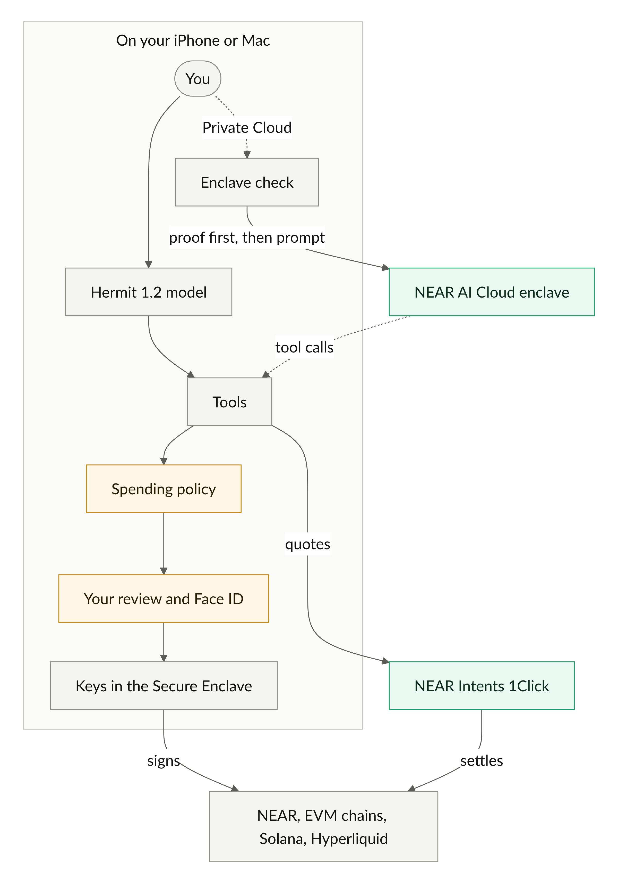

# Hermit

Hermit is a wallet for iPhone and Mac with an AI assistant that runs on the device. You ask it in plain words to swap,
bridge, trade or pay. It prepares the move, and nothing leaves your wallet until you approve it with Face ID or Touch
ID. We didn't want our balances and plans on somebody's server, so the model lives on your device. When a question
needs a bigger model, Hermit checks a NEAR AI Cloud enclave's proof before it sends a word.

## Try it

- Mac: https://hermit.my/dmg (notarized, Apple silicon, macOS 26)
- Mac TestFlight: https://testflight.apple.com/join/P66H5DF8
- iPhone TestFlight: https://testflight.apple.com/join/ed9vUh7d (iOS 26)
- Demo video: TODO

The model downloads on first launch (about 2.3 GB, 1 GB on smaller iPhones). It's mainnet: real swaps move real money.

## Things you can ask it

- "How much USDC on Solana would 0.5 ETH on Arbitrum get me?" gets a NEAR Intents quote and prepares nothing.
- "Swap 20 USDC on Base to NEAR" opens the Swap review, filled in from a NEAR Intents quote.
- "Swap 500 USDC on Base to NEAR" doesn't. The assistant can prepare up to $100 per move.
- "Long ETH with $50 at 5x" gives you a Review long ETH button for a Hyperliquid order.
- Drop in a spreadsheet of addresses and amounts and say "pay everyone in USDC on Base" for one batch review.

Turn off Wi-Fi and it still answers. Automations ("every morning at 8, brief me on the market") run while it's open.
There's also spot on Solana through Jupiter, Aave deposits, and a browser where web apps see a Hermit wallet.

## How we use NEAR

- [NEAR Intents](docs/NEAR.md#near-intents-1click) swaps and bridges across EVM chains, Solana, NEAR, Bitcoin and
  Hyperliquid, and funds the wallet from any chain. The device checks every quote's signature.
- [Private Cloud](docs/NEAR.md#private-cloud-on-near-ai-cloud) sends bigger questions to NEAR AI Cloud, but only after
  the device has checked the enclave's attestation. It checks the enclave's signature on each answer too.
- Every wallet has a [NEAR account](docs/NEAR.md#a-near-account-in-every-wallet), derived on the device.

## Check it yourself

On a Mac with Python 3.10 or later. No keys, no funds:

```sh
git clone https://github.com/Hermit-Ai-Labs/hermit-app && cd hermit-app
python3 -m venv .venv && .venv/bin/pip install -r near/requirements.txt
.venv/bin/python near/intents-quote.py        # a live dry quote, ends with [PASS] 1Click signature
.venv/bin/python near/near-account.py         # the NEAR account from a public test phrase, three [PASS] lines
.venv/bin/python near/verify-attestation.py   # NEAR AI Cloud's enclave, ends with 23 passed, 0 failed, 1 skipped
```

With Xcode 26, `bash scripts/core-tests.sh` runs the app's non-UI tests. [docs/VERIFY.md](docs/VERIFY.md) has every
step and what you should see, and [docs/BUILD.md](docs/BUILD.md) shows how to build the apps.

## How it works



By default the Hermit 1.2 model answers on your device, and your chats stay there. In Private Cloud mode the device
checks the enclave's proof first, then sends your prompt on that same connection. Either way the model can only call
tools. It never holds a key. Anything that moves money goes through the
[spending policy](docs/SECURITY-DEMO.md#the-spending-policy) and a review you approve, and only then do the keys sign.
They're sealed with a Secure Enclave key. There's no account and no analytics. The rest is in
[docs/SECURITY-DEMO.md](docs/SECURITY-DEMO.md), with a prompt-injection attack you can run.

## What doesn't work yet

- NEAR Intents has no testnet, so swaps are mainnet only. Try a quote and the `near/` scripts never move money.
- We trust 1Click's status API. The device doesn't check the destination chain itself.
- Quotes that pay out on Bitcoin fail the signature check. Hermit warns and asks you to check them yourself.
- There's no NEAR light client, so NEAR balances come from public RPC.
- Batch sends are EVM only. Spot and Memes are Solana only. Earn deposits are Aave v3 on three networks.
- [What the device checks, and what it doesn't](docs/NEAR.md#what-the-device-checks-and-what-it-doesnt) has the full table.

## Built at NEAR HACKATHON

We started this repository on 2026-10-29, ten days after the hackathon was announced, and tagged the first commit
`pre-hackathon`. The wallet, the on-device chat and the other chains (EVM, Solana, Hyperliquid) came first. The NEAR
work starts after commit `8fe7b71` on 2026-11-08: Private Cloud on NEAR AI Cloud, the NEAR account, NEAR Intents and
the spending policy. [This diff](https://github.com/Hermit-Ai-Labs/hermit-app/compare/8fe7b71...main) shows everything
since then.

The app uses swift-secp256k1, CryptoSwift, mlx-swift, mlx-swift-lm and swift-transformers, and the scripts use
requests, cryptography, eth-account and dcap-qvl. No templates or boilerplate. We wrote a lot of the code, tests and
docs with AI coding agents (Claude Code), and we review all of it ourselves.

MIT, see [LICENSE](LICENSE). Contact: contact@hermit.my. Team: TODO
