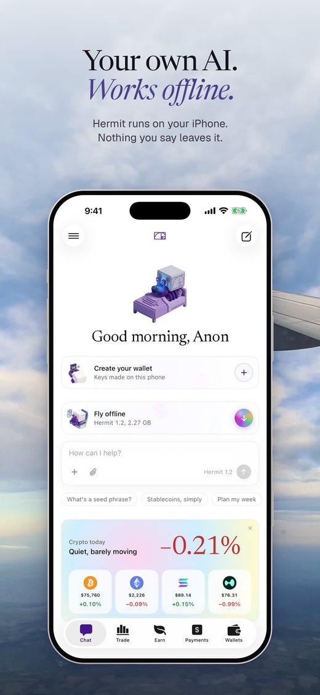
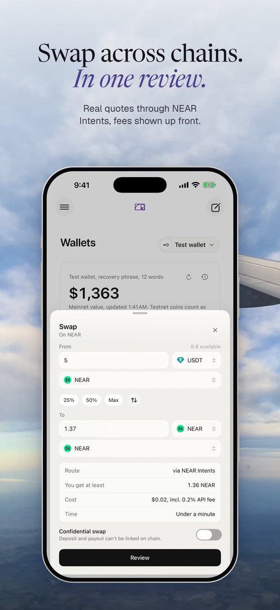
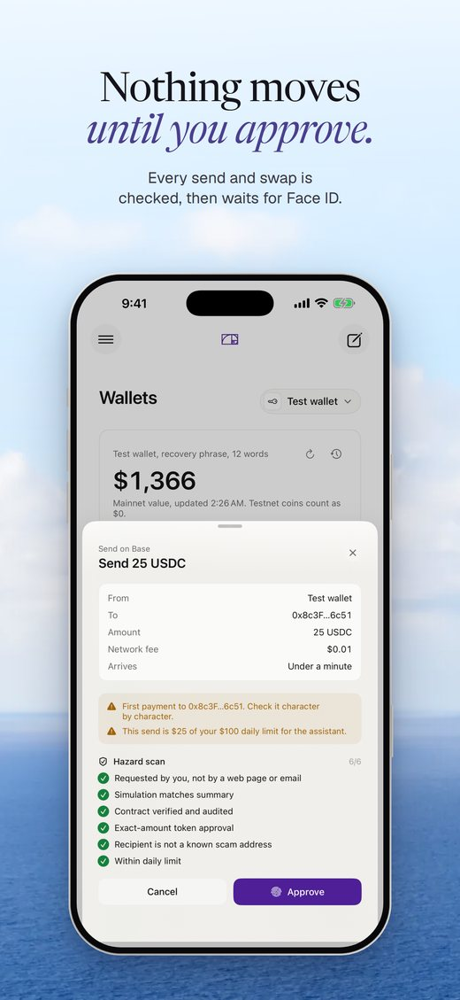
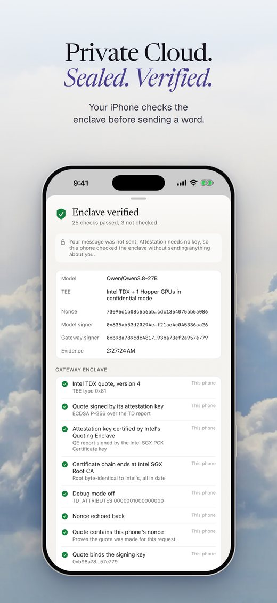

# Hermit

## Overview: A local agentic wallet for iPhone and Mac

Hermit is an **agentic wallet**. It is a **self-custody** crypto wallet run by a **local AI** that lives on your **iPhone or Mac**.

You type what you want in plain words, for example:

- "Long SOL with $200 at 5x, take profit at $90, stop loss 8% below entry."
- "Find the best USDC yield and put $1,000 in it."
- "Send 50 USDC to each of these 12 wallets."
- "Pay my designer 100 USDC every month."

**Done by hand**, these mean setting trigger orders on a perp exchange, comparing yield protocols, pasting addresses one
by one, or deploying a smart contract for recurring payments. Hermit's local AI **handles the technical part** and
prepares it for you.

The local AI **prepares every transaction** and shows you a review. **You approve**, and it is done.

Our goal is to **democratise on-chain finance**, so anyone can use strategies that today need a technical background.

## Ownership: Your keys never leave your device

- Your recovery phrase is encrypted with a key inside the device's **Secure Enclave**.
- It **never syncs to iCloud** and **never reaches our servers**.
- The private key is rebuilt in memory **only to sign a transaction you approved** with Face ID, Touch ID or your
  passcode. It is **wiped straight after**.
- The AI prepares transactions. It has **no way to sign** them.

## Pain point: On-chain finance is too technical for most people to use well

Bridging, lending and leverage each need their own app and real know-how. That **technical threshold** keeps most people
out.

An agentic wallet democratises this. But the AI in wallets today **runs on someone else's server**, so your balances
and plans leave your device.

Hermit's AI **runs locally**. **Nothing leaves your device.**

## What we built: Our own local AI, 30 money tools and 3 live NEAR contracts

- **Our own local model.** [Hermit 1.3](https://huggingface.co/aiquantgod/Hermit-1.3-4B-MLX-5bit) runs locally and
  offline.
  - 1,801 tests with **zero false "done" reports**.
  - 60 attack attempts, **zero requests for a private key** ([results](docs/MODEL-RESULTS.md)).
- **30 money tools** on EVM chains, Solana, NEAR, Bitcoin and Hyperliquid. Swaps and bridges run through NEAR Intents.
- **Private Cloud** on NEAR AI Cloud for harder questions. The device checks the server's secure-hardware proof first.
  Keys are never sent.
- **3 contracts on NEAR mainnet:**
  - [`hermit-blackbox.near`](https://nearblocks.io/address/hermit-blackbox.near) records our model hashes and a
    fingerprint of every AI transaction.
  - [`hermit-insurance.near`](https://nearblocks.io/address/hermit-insurance.near) covers you against AI mistakes for
    1 USDC per 30 days.
  - [`hermit-guard.near`](https://nearblocks.io/address/hermit-guard.near) gives AI agents a spending budget on chain.

## Progress: 39 app builds in two weeks, fully open source

- **39 TestFlight builds** (24 iPhone, 15 Mac).
- **4 models** trained and published, hashes on chain.
- **298 app tests** passing ([log](docs/logs/core-tests-2026-11-13.txt)).
- **MIT licensed** code and **public training data** ([hermit-training](https://github.com/Hermit-Ai-Labs/hermit-training)).

## Product: A live agentic wallet on iPhone and Mac today

Try it: [Mac](https://hermit.my/dmg) · [iPhone TestFlight](https://testflight.apple.com/join/ed9vUh7d) ·
[Mac TestFlight](https://testflight.apple.com/join/P66H5DF8)

## Revenue model: Swap fees from users, licences from businesses

Wallets make money from swap fees (MetaMask, Phantom) and from business products (MetaMask Institutional, Privy,
Dynamic). Hermit earns from **both**. The app is **free today**.

**Users pay for:**

- A small **swap fee**, through our NEAR Intents partner key.
- **Private Cloud** above the free tier.

**Businesses pay for:**

- The **Hermit SDK**, which runs our local AI and approval flow inside their exchange or fintech app. Priced **per monthly
  active user**.
- A **custom model** trained on their own tools. Setup fee plus licence.
- **Black Box, insurance and Guard** for their own AI agents.

## Team: Founders who have already built and scaled a trading agent

**[Ryan Chi](https://x.com/MrRyanChi)** ([site](https://www.ryanchi.com/))

- Co-founded [insiders.bot](https://x.com/insidersdotbot), a prediction-market agent on Polymarket and Predict.fun.
  Peak **US$360K ARR** and **$1M+ monthly volume**.
- Guest lecturer on the **HKU MBA**.
- Co-president of **0xU Club**, Hong Kong's largest Web3 student group.
- **UPenn** (FranklinDAO) and **CUHK**.

**[Daksh Joshi](https://x.com/dakshbigshit)** ([LinkedIn](https://www.linkedin.com/in/joshidaksh/))

- Co-founded **insiders.bot** with Ryan, and **Sigmaboy.ai**.
- Technical BD at **Astralane** (low-latency trading infrastructure). Formerly **CPO at PublicAI**.
- Guest lecturer in **Solidity and DeFi** for a **CUHK Business School** master's course.
- CUHK finance and maths.

[hermit.my](https://hermit.my) · [Demo](https://x.com/MrRyanChi/status/2121186366537244978) · [Docs](https://docs.hermit.my) · contact@hermit.my
